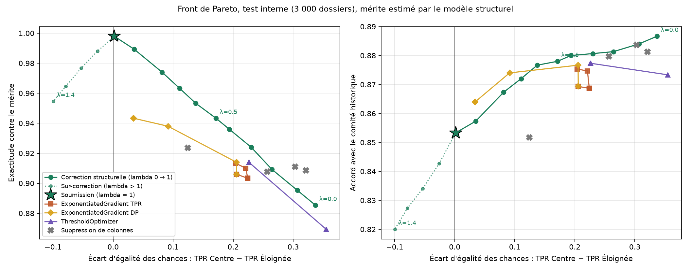

# ÉquiAlgo : corriger le comité, pas seulement le modèle

Défi IVADO ÉquiAlgo, Hackathon Génie & Informatique 2026. L'énoncé original se trouve dans [`enonce/`](enonce/).

Le comité qui a produit `decision_octroi` appliquait une **pénalité fixe d'environ 1,6 point de cote R** à toute candidature des régions éloignées. Le modèle en production l'a apprise. Nous la mesurons, l'isolons, la retirons, et proposons un plan pour qu'elle ne revienne pas.

## Livrables

| Fichier | Contenu |
|---|---|
| [`predictions.csv`](predictions.csv) | 4 000 décisions, taux d'octroi de **40,0 %** |
| [`audit_rapport.ipynb`](audit_rapport.ipynb) | Mesure du biais, mécanisme, décomposition, proxys, choix et justification de la métrique |
| [`model_corrige.py`](model_corrige.py) | Correction, comparaison avec fairlearn, **front de Pareto**, validation semi-synthétique |
| [`presentation.pdf`](presentation.pdf) | Support du pitch de 5 minutes (source : [`presentation/slides.html`](presentation/slides.html)) |
| [`GOUVERNANCE.md`](GOUVERNANCE.md) | Éthique, droits des candidats, **plan de surveillance** en production |
| [`surveillance.py`](surveillance.py) | Tableau de bord de surveillance exécutable sur une cohorte |
| [`equite.py`](equite.py) | Module partagé : modèle du comité, score de mérite, métriques |

## Résultats clés

**Diagnostic** (`audit_rapport.ipynb`)

- Écart d'octroi de 21,1 points (48,4 % contre 27,3 %), ratio d'impact de 0,56.
- Une logistique décrit très bien le comité. Sa pénalité régionale est de **−2,15 logit**, soit **−1,56 point de cote R** (IC95 : −1,74 à −1,38). Elle est identique dans les trois régions éloignées (p = 0,75) et constante quel que soit le dossier (aucune interaction, p = 0,58).
- Décomposition de Shapley des 21 points :

  | Composante | Points d'écart |
  |---|---|
  | Pénalité directe | +17,6 |
  | Cote R | +7,4 |
  | Préférence pour les revenus élevés | +4,4 |
  | Heures de travail | −6,5 |
  | Autres | −1,7 |

- Proxys de la région (AUC) : code postal 1,00, distance 0,998, heures 0,81, revenu 0,69. Si on retire la région, la pénalité migre dans la distance : son coefficient passe de +0,001 à −0,005 par km.
- Mesuré contre `decision_octroi`, l'écart d'égalité des chances du modèle de production n'est que de 0,06. Mesuré contre le mérite, il atteint 0,32.

**Correction** (`model_corrige.py`)

1. On estime le comité **avec** l'indicatrice de région, pour qu'elle absorbe la pénalité au lieu de la laisser fuir dans les proxys.
2. On ne garde que le mérite légitime : **Mérite = 1,39 × cote R + 0,20 × heures**. Sont exclus la région, le revenu, la distance et le code postal.
3. On accorde la bourse aux **40 % meilleurs scores**, avec un seul seuil qui ne lit jamais la région.

| Sur les 4 000 candidats | Production | Corrigé |
|---|---|---|
| Taux d'octroi | 39,0 % | 40,0 % |
| Écart d'égalité des chances (mérite estimé) | 0,295 | 0,000 |
| Écart de parité démographique | 0,190 | 0,000 |
| Ratio d'impact | 0,59 | 1,00 |
| **Exactitude contre le « mérite réel » (HxBuddy)** | n/a | **94,63 %** (F1 macro 94,40 %) |

**Métrique retenue : l'égalité des chances.** Elle est mesurée contre un mérite estimé, jamais contre les décisions du comité. La justification complète est dans l'audit, section 6.

**Front de Pareto.** On balaie la force de la correction λ de 0 (le comité) à 1,4 (sur-correction). On compare à `ExponentiatedGradient` (parité des TPR et parité démographique), à `ThresholdOptimizer` et à la suppression de colonnes. En validation semi-synthétique, où le vrai mérite est connu, notre méthode atteint **99,3 % d'exactitude avec un écart de 0,009**. Le meilleur outil fairlearn atteint 95,2 %.



## Choix de la définition du mérite

L'étalon du jury est caché. Les définitions plausibles du mérite (cote R seule, avec les heures, avec le revenu) diffèrent sur 5 à 12 % des candidats. Nous les avons départagées avec le **score indicatif de HxBuddy**, qui donne l'exactitude contre le « mérite réel ». Dix soumissions au total, toutes conservées dans [`sondes/`](sondes/), avec leurs résultats dans [`sondes/resultats_hxbuddy.csv`](sondes/resultats_hxbuddy.csv).

| Sonde | Mérite testé | Exactitude | Écart vs B |
|---|---|---|---|
| **B** | **cote R + heures (retenu)** | **94,63 %** | n/a |
| I | B, avec 42 % d'octroi | 94,43 % | −0,20 |
| J | B, avec 38 % d'octroi | 94,38 % | −0,25 |
| H | B, poids des heures plus faible | 93,98 % | −0,65 |
| G | B, poids des heures plus fort | 93,68 % | −0,95 |
| D | B + bonus première génération | 93,43 % | −1,20 |
| E | B + bonus régions éloignées | 93,33 % | −1,30 |
| F | B + bonus revenus faibles | 93,18 % | −1,45 |
| A | cote R + heures + revenu (le comité sans sa pénalité) | 92,53 % | −2,10 |
| C | cote R seule | 92,18 % | −2,45 |

Ce que montrent ces dix soumissions :

- **Le revenu est un biais du comité.** L'ajouter coûte 2,1 points.
- **Le travail rémunéré fait partie du mérite.** Retirer les heures coûte 2,5 points.
- **B est un optimum dans toutes les directions testées.** Chaque variation fait baisser le score.
- **L'écart restant est un aléa individuel.** Un modèle « étalon = B + bruit logistique d'environ 0,3 point de cote R » reproduit les dix exactitudes à environ 0,3 point près. Il prédit aussi un écart de 0,28 pour le modèle de production, contre **0,270** annoncé dans l'énoncé (audit, section 7).

Nous avons aussi traité les dix scores comme des comptes exacts sur 4 000 candidats, et ajusté par maximum de vraisemblance les poids de l'étalon, son bruit et son taux ([`sondes/analyse_sondes.py`](sondes/analyse_sondes.py)). Résultats :

- **Poids des heures : 0,141**, compatible avec le 0,146 de B (p = 0,45).
- **Première génération, région et revenu : poids non significatifs** (p = 0,32).
- **Bruit : 0,31 point de cote R ; taux de l'étalon : 40,6 %.**
- **Le meilleur taux de sélection reste 40 %**, avec une exactitude attendue de 94,64 à 94,68 %.

Aucune règle fondée sur les variables observées ne peut donc faire mieux en espérance que B. **Le plafond se situe vers 94,7 %**, et B obtient 94,63 %.

Nous avons volontairement arrêté les soumissions là. Continuer à soumettre pour retourner des décisions individuelles reviendrait à apprendre l'étalon par le classement, pas à mieux modéliser le mérite. Ce serait inutile pour l'institution et contraire à l'esprit du défi.

**Score attendu selon ce modèle.** L'écart d'égalité des chances de notre soumission serait d'environ 0,01, soit environ 97 % de l'écart de 0,270 comblé. Pour l'utilité, l'exactitude de 94,63 % correspond à 89 % du chemin entre un tirage aléatoire et une allocation parfaite.

## Reproduire

```bash
python3 -m venv venv && source venv/bin/activate
pip install -r requirements.txt
python model_corrige.py                                          # front de Pareto, validation, predictions.csv (~30 s)
jupyter nbconvert --to notebook --execute --inplace audit_rapport.ipynb
python surveillance.py                                           # tableau de bord sur la cohorte d'evaluation
```

Le carnet de départ fourni par les organisateurs est conservé tel quel : [`baseline_model.ipynb`](baseline_model.ipynb).

## Structure

```
├── predictions.csv            soumission
├── audit_rapport.ipynb        diagnostic
├── model_corrige.py           correction et front de Pareto
├── equite.py                  modele du comite, score de merite, metriques
├── surveillance.py            indicateurs de production
├── GOUVERNANCE.md             ethique et plan de surveillance
├── presentation.pdf           pitch (source : presentation/slides.html)
├── figures/                   figures generees
├── resultats/                 tables du front de Pareto et de la validation
├── sondes/                    soumissions de controle (definition du merite)
├── baseline_model.ipynb       carnet de depart (fourni)
├── data/                      donnees (fournies, synthetiques)
└── enonce/                    enonce original (fourni)
```

## Outils, sources et modèles utilisés

- **Langage et bibliothèques** : Python 3.13, pandas, NumPy, scikit-learn (forêt aléatoire de production, régression logistique), **statsmodels** (régression logistique du comité, intervalles de confiance, tests du rapport de vraisemblance), **fairlearn** (`ExponentiatedGradient`, `ThresholdOptimizer`, comparaison), SciPy, Matplotlib, Jupyter. Le PDF est rendu par Google Chrome en mode headless.
- **Assistant d'IA** : le code, les analyses et les documents ont été produits avec l'aide de **Claude Code (Anthropic, modèle Claude Opus 5.5)**. L'équipe a relu, exécuté et validé chaque résultat.
- **Références** :
  - Hardt, Price et Srebro (2016), *Equality of Opportunity in Supervised Learning* : définition de l'égalité des chances.
  - Wick, Panda et Tristan (2019), *Unlocking Fairness: a Trade-off Revisited* : quand les étiquettes sont biaisées, équité et exactitude ne s'opposent pas forcément.
  - Shapley (1953) : décomposition de l'écart.
  - *Charte des droits et libertés de la personne* du Québec, art. 10.
  - *Loi sur la protection des renseignements personnels dans le secteur privé*, art. 12.1 (Loi 25).
- **Données** : entièrement synthétiques, fournies par les organisateurs. L'institution est fictive.
